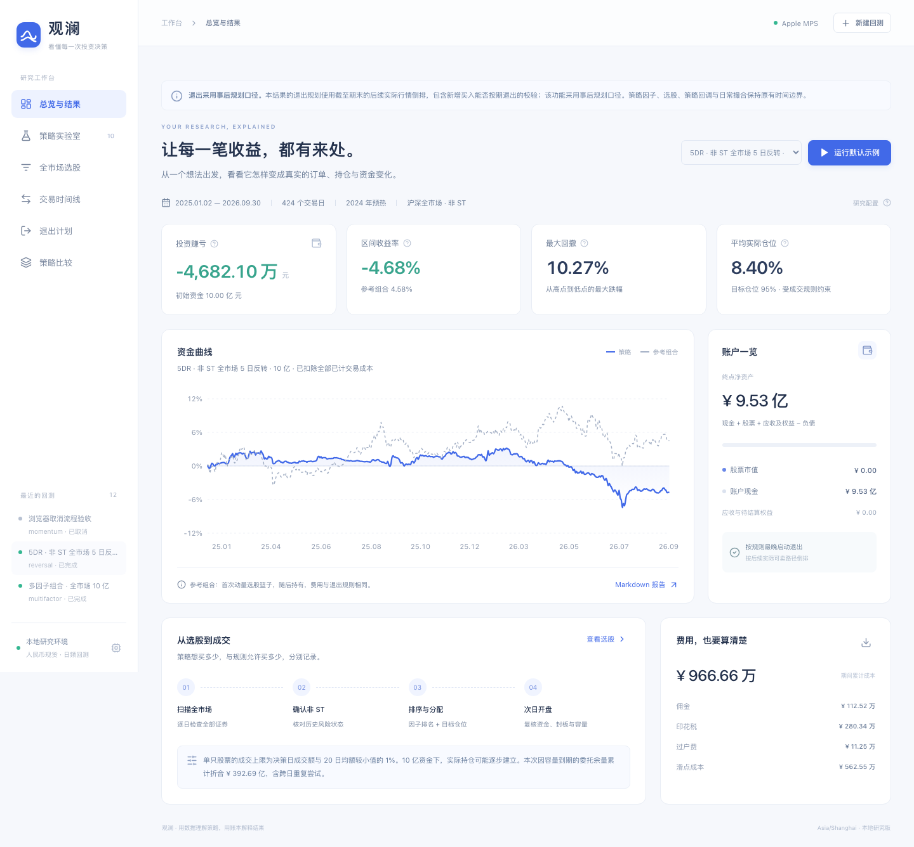

# 观澜 · A 股全市场回测工作台

本地 Python 回测引擎、中文浏览器工作台和可逐笔追溯的资金账本。默认从矩阵覆盖的沪深股票中逐日筛选历史非 ST 股票，并用 20 日复权动量形成目标组合。



从 [5DR 中文报告与金额说明](reports/5dr/README.md) 或 [完整验收记录](验收记录.md) 开始阅读。

## 打开工作台

准备 Python 3.11、Node.js 22，以及 Apple Silicon 的 MPS 或 NVIDIA CUDA 环境。在项目根目录安装：

```bash
python3.11 -m venv .venv
.venv/bin/pip install -e '.[dev]'
npm --prefix web ci
npm --prefix web run build
```

行情来自 [课程数据 Release](https://github.com/aslan9/pku_quantllm/releases/tag/data-backtest-20261016)。下载 `feathers.zip` 并解压，使项目根目录具有以下结构：

```text
feathers/
  open.feather  high.feather  low.feather  close.feather
  amt.feather   num_trades.feather        cumadj.feather
```

课程原始压缩包 SHA-256 为 `5766950f2a105244867b842709cf4bad890e4e11df0eebeeaa4fec42dc05803d`。原始行情由课程发布，历史状态与计算缓存由本地程序准备。运行时会先截取 2024 年预热至 2026-09-30，再进行校验、计算和业绩统计。

随后启动：

```bash
.venv/bin/ashare-bt ui
```

访问 <http://127.0.0.1:8765>。macOS 也可在 Finder 双击 `启动工作台.command`。首页运行默认示例；策略实验室提供 10 类策略。完成后可在全市场选股、交易时间线、退出计划和比较页面查看结果。

仓库保存代码、[十类策略汇总](data/full-acceptance.json)、[5DR 报告](reports/5dr/report.html)和验收证据。运行后，完整逐笔结果保存在本机 `runs/<运行编号>`，源码交付包可通过 `.venv/bin/python tools/package_source.py` 生成到 `data/source-delivery.zip`。

中文报告采用 **5DR（5 日反转）**作为样例：[阅读说明](reports/5dr/README.md) · [下载 HTML 报告](reports/5dr/report.html)。5DR 先计算过去 5 个交易日的复权收益，再从低到高选择合格股票。例如，甲从 10 元跌到 9 元，乙从 10 元跌到 9.80 元，甲的 5DR 为 −10%，排序优先于乙的 −2%。每 5 个交易日调整，最多 20 只、95% 目标仓位；样例配置为 `configs/5dr.toml`，资金、费用、历史状态、容量和退出规则沿用本项目已确认的设置。

GPU 任务按顺序执行，任务配置与进度保存在 `work/jobs`，页面刷新后可继续查看。首次使用会下载并缓存 425 个决策及交易日的 BaoStock 历史状态快照；每个快照独立保存，支持断点继续。正式默认结果要求待选股票日的历史 ST 状态覆盖完整。

## 默认实验

| 项目 | 配置 |
|---|---|
| 交易与业绩期间 | 2025-01-02 至 2026-09-30，424 个交易日 |
| 预热与首单 | 2024 年预热；2024-12-31 收盘决策，2025-01-02 开盘开始执行 |
| 账户 | 人民币现货多头，初始资金 10 亿元，T+1 |
| 费用 | 佣金单边万一，每单最低 5 元；卖出印花税万五；历史过户费；独立滑点万五 |
| 策略 | 20 日复权动量，每 5 日调整，最多 20 只，目标仓位 95% |
| 资格 | 历史非 ST、至少 60 日有效历史、20 日均额至少 2,000 万元 |
| 容量 | 每证券共享 1% × min（决策日成交额，决策日及此前 20 日均额） |
| 执行 | 决策日固定数量，次日原始开盘价复核，卖先买后，余量单次开盘后到期 |
| 退出 | 默认按已知容量逐日更新最晚启动计划；另提供末日强制结清及末日按规则退出 |
| 计算 | Apple MPS 或 NVIDIA CUDA，float32 连续内存、128 日分块；资金顺序 Decimal 记账 |

“全市场”指扫描七矩阵覆盖的全部沪深证券，再识别股票。矩阵共有 5,451 列证券；689009.SH 按 CDR 识别，默认股票范围为其余 5,450 列。持仓上限与扫描范围分别配置。逐日保存过滤理由、分数、排名及最终目标。

研究假设和来源会进入每份报告：当日累计复权因子推定在开盘前生效；完整日线的当日成交额用于开盘记录有效性核验；BaoStock 逐日 ST 状态推定在当日开盘前可知。带明确可获知时间的状态文件与注入事件按其时间执行。高低收字段在收盘用于诊断和信号。

退出估算随已知信息更新。封板、行情中断或容量下降可能留下受限权益；报告分别列示现金、持仓、应收、待上市权益和负债。选择末日强制结清时，额外的估值变现及费用单独列示。

## 命令行

```bash
.venv/bin/ashare-bt audit-data --config configs/default.toml
.venv/bin/ashare-bt audit-data --config configs/default.toml --sync-status
.venv/bin/ashare-bt run --config configs/default.toml
.venv/bin/ashare-bt run --config configs/5dr.toml
.venv/bin/ashare-bt run --strategy reversal --exit-mode strict_end
.venv/bin/ashare-bt explain-trade runs/运行编号 T00000001
.venv/bin/ashare-bt list-events --framework rqalpha
.venv/bin/ashare-bt list-events --run runs/运行编号
.venv/bin/ashare-bt run --replay runs/运行编号
```

TOML 配置见 `configs/default.toml`。`run --replay` 读取已有配置及原始输入事件快照，使用当前项目代码完整重算；源码快照和哈希可用于核对版本。事件观察流是 `events.jsonl`，可用于输入重放的规范化外部事件是 `input_events.jsonl`。

每个 `runs/<运行编号>/` 包含中文 `report.html`，以及订单、成交、借贷分录、净值、费用、持仓、退出估算、终点假设、选股、证券池和诊断的 Parquet 文件；主要表另有 UTF-8 BOM CSV。`manifest.json` 保存依赖、计算设备、原始数据及状态指纹、源码哈希；`source/` 保留本次应用源码快照。

容量受限金额是因共享容量到期的委托余量按该次开盘价折算，跨日累计、含重复尝试，买卖双向合计。它描述委托执行约束，结合目标仓位和实际仓位一起阅读。

## 策略接口

内置：单标的买入持有、高流动性等权、动量轮动、短期反转、双均线趋势、通道突破、低波动、RSI 回归、布林带回归、多因子组合。排名轮动按调仓周期执行，信号型策略逐日检查进出条件。分配方式为等权或逆波动率。

信号型策略优先延续仍满足条件的持仓，再按决策时已知的 20 日平均成交额补充名额。单标的策略会持续尝试至首次实际成交，随后持有；初次部分成交形成的实际仓位受同一容量规则约束。

```python
from ashare_bt import Config, ComposedStrategy, run

config = Config()
strategy = ComposedStrategy(config, selector=lambda history: history.factor("mom_20"))
result = run(config, strategy)
print(result.summary["net_profit"])
```

公共接口为 `Strategy.on_close(history, portfolio) -> TargetWeights`、`Strategy.on_event(event, context)`、`EventSource`、`FactorProvider`、`StrategyRegistry` 和 `run`。`history.prices`、`history.factor` 只返回截至当前时点的历史；`history.announcements` 与 `context.known_events` 仅包含已经可获知的事件，经济处理仍等待生效时间。

`ComposedStrategy` 可组合证券池、选股、择时、分配器与调仓间隔。注册插件声明 `StrategySpec` 后，可通过 Python entry point 组 `ashare_bt.strategies` 接入工作台。CLI 也支持 `python:模块:类名`。财务扩展示例见 `examples/fundamental_strategy.py`，给出价值、质量、成长字段及公告/修订时间契约。

## 公司行动与扩展数据

`total_return` 模式使用累计复权因子的总收益等价单位，原始价格用于成交和费用，持仓数量注明等价含义。`explicit` 模式使用原始股数、现金、应收及待上市权益，同一经济影响按选定模式计入一次。

JSONL 每条事件包含 `event_id/type/security/effective_at/known_at/payload/source`。支持分红登记、除息、支付，拆并股、送转、零碎权益、默认放弃或注入申购的配股、换股合并、分拆、代码转换、退市对价、入出金和显式税额。`examples/corporate_actions.jsonl` 演示人工字段结构；人工金额验收使用 `tests` 中的小型数据，真实研究配套真实事件明细。

`Ledger.register_handler` 和 `run(..., event_handlers=...)` 可注入自定义处理器。Tick、盘口队列、融资融券、期货交割、期权行权和实盘连接的触发、字段及资产模型契约在 `src/ashare_bt/extensions.py`，逐项来源映射在 `research/event_mapping.md` 和 `event_catalog.json`。

## 项目结构

```text
src/ashare_bt/
  data.py、status.py、compute.py   数据、时点状态与 GPU 因子
  events.py、extensions.py       事件、固定时区及扩展契约
  strategies.py                 策略与组合接口
  rules.py、execution.py         数量、费用、撮合与退出计划
  ledger.py                     Decimal 现金、成本与权益总账
  analytics.py                  统计、中文报告及版本清单
  cli.py、server.py、worker.py   CLI、本地 API 与串行队列
web/                            React / TypeScript 工作台
research/sources/               固定提交源码与课程快照
tools/                          数据、GPU、全量验收与发布工具
reports/5dr/                    已核验的 5DR 中文报告与聚合结果
validation/                     测试、重放及批准批次的验收证据
```

五个固定源码边界：RQAlpha `284b78a1`、LEAN `a54e9cc6`、Zipline `014f1fc3`、Backtrader `b853d7c9`、Qlib `54355232`。当前目录逐项映射 177 项，涵盖 RQAlpha 45 个核心事件、Zipline 13 类消息与 5 类时钟，以及其余回调、状态和账户钩子。

## 开发与验收

新环境使用 Python 3.11 和 Node.js 22：

```bash
python3.11 -m venv .venv
.venv/bin/pip install -e '.[dev]'
npm --prefix web ci
npm --prefix web run build
.venv/bin/python -m pytest
.venv/bin/python tools/validate_gpu.py --device mps
.venv/bin/python tools/validate_gpu.py --device cuda
```

CUDA 环境安装匹配 NVIDIA 驱动的 PyTorch CUDA 发行版。验证工具会实际选择请求的设备，并核对 64/128/256 日边界、检测结果、原始精度动量和逐日前 20 名。当前 Mac 的 MPS 实机证据在 `data/mps_validation.json`；CUDA 实机证据由 NVIDIA 环境运行同一工具后生成。

```bash
.venv/bin/python tools/prepare_status.py
.venv/bin/python tools/run_acceptance.py
PLAYWRIGHT_BROWSERS_PATH=/private/tmp/ashare-playwright npm --prefix web exec -- playwright install chromium
PLAYWRIGHT_BROWSERS_PATH=/private/tmp/ashare-playwright npm --prefix web run test:e2e
```

全量运行检查保存在 `data/full-acceptance.json`；本次浏览器证据见 `validation/browser-tests.json`，5DR 页面截图见 `docs/images/`。重新运行的浏览器结果及截图保存在本机 `work/`。

课程与数据入口：[课程仓库](https://github.com/aslan9/pku_quantllm)、[第四讲 issue #8](https://github.com/aslan9/pku_quantllm/issues/8)。第三方源码快照的版本、版权和原始许可见 [来源说明](THIRD_PARTY_NOTICES.md)；项目运行代码位于 `src/ashare_bt`。
