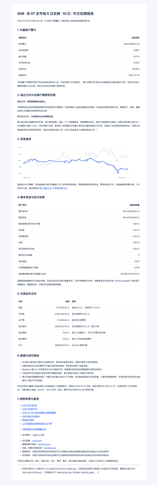

# 5DR：用一个小例子读懂整份回测

5DR 样例观察过去 5 个交易日的复权收益，从合格股票里优先选择近期跌幅较大的股票，研究短期回升的可能。它每 5 个交易日调整一次，最多持有 20 只，目标投入账户净资产的 95%。

## 先看金额

假设甲的复权价格从 10 元跌到 9 元，5 日收益为 −10%；乙从 10 元跌到 9.80 元，收益为 −2%。本样例让甲排在乙前面。这组小金额方便手算，正式回测账户使用 **10 亿元人民币**。

公式为 `5DR = 当日复权收盘价 / 5 个交易日前复权收盘价 − 1`，按从低到高排序；同分时按证券代码排序。复权收盘价为原始收盘价乘以累计复权因子。

## 这次发生了什么

| 项目 | 实际结果 |
|---|---:|
| 交易与业绩区间 | 2025-01-02 至 2026-09-30，424 日 |
| 初始资金 | 1,000,000,000.00 元 |
| 首笔成交 | 2025-01-02 开盘 |
| 投资赚亏 | -46,820,990.07 元 |
| 区间收益 | -4.68% |
| 最大回撤 | 10.27% |
| 目标仓位 / 平均实际仓位 | 95% / 8.40% |
| 期末净资产 | 953,179,009.93 元 |
| 期末现金 | 953,179,009.93 元 |
| 期末股票及等价持仓市值 | 0.00 元 |
| 已计交易成本 | 9,666,607.54 元 |

收益是这组已声明规则下的历史模拟结果。95% 表示策略想投入多少；8.40% 表示实际平均投入多少。10 亿元资金下，逐证券的开盘容量和买卖限制会影响建仓与退出。期末股票、应收款及待结算权益均为 0，全部净资产体现为现金。

**退出采用事后规划口径。** 仅退出倒排及新增买入的退出可行性校验使用截至期末的后续实际行情；策略因子、选股、策略回调和日常撮合保持原有时间边界。每次开盘容量仍按其前一决策日的成交额与此前 20 日均额较小值的 1% 计算，逐日重放封板、行情、T+1 和数量规则。报告使用实际可卖路径倒排最晚启动日，正常模拟成交后结清。

例如，某只股票持有 500 股，倒数第二个开盘实际可卖 1,000 股，最后一个开盘因容量下降只能卖 100 股，退出会在倒数第二个开盘启动。这个例子展示倒排规则，正式运行逐证券保存实际路径。

[Markdown 中文报告](report.md)包含完整资金曲线、成本、状态覆盖和研究假设。可在 GitHub 或 Markdown 阅读器中打开，资金曲线位于同目录。[账户净值 CSV](equity.csv)和[参考净值 CSV](benchmark_equity.csv)提供聚合曲线；精确金额和配置见 [summary.json](summary.json) 与 [config.json](config.json)。



## 实际退出记录

本次 5DR 的末期记录展示了容量变化怎样影响启动日：

| 证券 | 持仓单位 | 实际启动日 | 结清日 |
|---|---:|---|---|
| 000668.SZ | 41,900 | 2026-09-29 | 2026-09-29 |
| 600499.SH | 347,800 | 2026-09-29 | 2026-09-29 |
| 600644.SH | 407,200 | 2026-09-28 | 2026-09-29 |
| 688117.SH | 87,630 | 2026-09-29 | 2026-09-29 |

600811.SH 的新增买入由退出功能校验其后续实际可卖路径后过滤。总收益等价单位中的零碎权益随整股退出结算，冻结数量按在途订单逐项重算。逐证券路径与真实成交可在本地退出页面及账本查看。

## 如何重跑

完成根目录 README 的安装与课程数据准备后运行：

```bash
.venv/bin/ashare-bt run --config configs/5dr.toml
.venv/bin/ashare-bt ui
```

该配置明确使用 `strategy = "reversal"`、`window = 5` 与等权分配。2024 年数据用于预热，2024-12-31 收盘生成首批委托。收盘决定数量，次日开盘按实际价格、历史非 ST、资金、数量、容量和方向限制执行；默认仅在退出模块使用后续实际行情，倒排最晚启动退出日，并校验新增买入的退出可行性；报告明确标记事后规划口径。

## 代码与证据

- [样例 TOML](../../configs/5dr.toml)：资金、费用、期间、窗口和仓位。
- [实际退出路径](../../src/ashare_bt/exit_path.py)：退出专用后续行情访问与真实撮合规则重放。
- [退出验收](../../data/actual-exit-check.json)：逐日开盘价、共享容量、时间范围与期末结清核对。
- [策略实现](../../src/ashare_bt/strategies.py)：`BuiltinStrategy.score`、`refine_ranking` 与 `raw_scores`。
- [结果清单](manifest.json)：设备、依赖、数据及状态指纹、应用源码哈希。
- [5DR 核对](../../data/5dr-report-check.json)：完整 424 日重算，十张表与已验收的 5 日反转运行逐项一致。
- [课程讨论](https://github.com/aslan9/pku_quantllm/issues/8#issuecomment-6215092680)：5DR 的正向和反转用法；本报告采用反转方向，并使用本项目的资金、费用和执行规则。

公开报告保存聚合结果与运行时源码哈希；本地运行的订单、成交、借贷分录、证券池及逐日选股保存在 `runs/<运行编号>`。财务与策略实现按来源清单核对，工作台服务与界面的发布整理另行测试。历史状态、当日复权因子和成交额的研究假设见 Markdown 报告的“结果的解释边界”。
