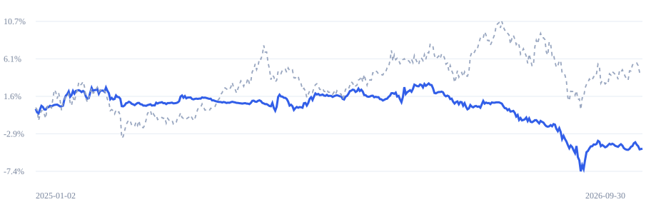

# 5DR · 非 ST 全市场 5 日反转 · 10 亿 · 中文回测报告

2025-01-02 至 2026-09-30，共 **424 个交易日**。初始资金 **1,000,000,000.00 元**。

## 1. 先看账户赚亏

| 观察项目 | 实际结果 |
|---|---:|
| 投资赚亏 | -46,820,990.07 元 |
| 区间收益率 | -4.68% |
| 最大回撤 | 10.27% |
| 平均实际仓位 | 8.40% |
| 目标仓位 | 95.00% |
| 首笔成交 | 2025-01-02 |

“投资赚亏”是期末净资产减去初始资金和净入金，已经扣除已计交易成本。“最大回撤”表示资金从此前最高点回落的最大比例。目标仓位表示策略希望投入的比例，实际仓位由成交和账户规则形成。

## 2. 退出方式与后续行情使用范围

**退出方式：按规则最晚启动退出。**

本结果的退出规划使用截至期末的后续实际行情倒排，包含新增买入能否按期退出的校验；该功能采用事后规划口径。策略因子、选股、策略回调与日常撮合保持原有时间边界。

期末退出状态：**已结清持仓及待结算权益**。

默认退出逐开盘重放实际价格、逐日规则容量、封板、T+1 与数量规则，倒排最晚启动日。每次开盘容量仍为其前一决策日成交额与此前 20 日均额较小值的 1.00%，同证券累计共享。新增买入按容量允许的最大潜在成交量校验退出可行性，实际买入再由资金和规则决定。后续公告继续按当前可获知时间筛选。该退出功能形成的订单、持仓与收益具有上述事后规划口径。[^exit]

## 3. 资金曲线

蓝线表示本次策略，灰色虚线表示首次动量篮子买入持有的参考组合；两者使用相同初始资金、费用和退出方式。收益曲线按份额计量，入出金另行记录。聚合曲线见 [账户净值 CSV](equity.csv) 与 [参考净值 CSV](benchmark_equity.csv)。

## 4. 期末资金与执行结果

| 账户项目 | 金额或数量 |
|---|---:|
| 期末净资产 | 953,179,009.93 元 |
| 期末现金 | 953,179,009.93 元 |
| 期末股票及等价持仓市值 | 0.00 元 |
| 应收款 | 0.00 元 |
| 待结算权益 | 0.00 元 |
| 负债 | 0.00 元 |
| 陈旧估值对应市值 | 0.00 元 |
| 期末持仓证券数 | 0 |
| 成交笔数 | 3,207 |
| 记录容量限制的订单数 | 8,335 |
| 因容量到期的委托余量累计折合 | 39,268,779,219.15 元 |

容量受限金额按各次开盘价折算，包含买卖双向及跨日重复尝试；它用于解释执行约束。完整逐笔运行目录中的 `exits.parquet` 保存逐日容量路径、最晚启动日、实际卖出进度和剩余数量。

## 5. 交易成本去向

| 项目 | 金额 | 规则 |
|---|---:|---|
| 佣金 | 1,125,193.26 元 | 单边万分之 1，每单至少 5.00 元 |
| 印花税 | 2,803,442.55 元 | 卖出金额的万分之 5 |
| 过户费 | 112,509.64 元 | 按历史生效费率 |
| 滑点成本 | 5,625,462.09 元 | 成交金额的万分之 5，独立计费 |
| 显式税款 | 0.00 元 | 依注入金额应计，支付与负债分别记账 |
| 显式费用 | 0.00 元 | 依注入的实际金额事件 |
| 合计 | 9,666,607.54 元 | Decimal 逐笔记账 |

## 6. 数据与研究假设

- 当日累计复权因子推定为开盘前生效，使用总收益等价单位；原始价格用于成交和费用。
- 完整日线的当日成交额用于开盘记录有效性核验；高低收价格用于收盘诊断。
- BaoStock 逐日 ST 状态推定在当日开盘前可知；带明确可获知时间的覆盖事件按其时间执行。
- 价格边界为历史规则与复权参考价推算的候选，首次观测与业务上市事实分别记录。
- 每次开盘的容量使用其前一决策日成交额与此前 20 日均额；退出模块按这些已实现容量、开盘价和限制倒排，专用后续行情访问包含新增买入退出可行性校验。

历史状态审计覆盖 **2,155,920 / 2,155,920** 个待选股票日。预热自 2024-01-01 开始，首批决策日为 2024-12-31；业绩仅统计上列交易区间。计算设备为 **mps**，float32、128 日分块。现金、费用与成本采用 Decimal 顺序记账。

## 7. 规则来源与复现

- [2025 年交易日历](https://www.sse.com.cn/disclosure/dealinstruc/closed/c/c_20241223_10767110.shtml)
- [2026 年国庆休市](https://www.sse.com.cn/disclosure/announcement/general/c/c_20260915_10832273.shtml)
- [2026-07-06 主板风险警示涨跌幅调整](https://www.sse.com.cn/aboutus/mediacenter/hotandd/c/c_20260424_10816474.shtml)
- [证券交易印花税减半](https://shanxi.chinatax.gov.cn/web/detail/sx-11400-545-1780448)
- [零股卖出规则](https://www.sse.com.cn/lawandrules/guide/stock/jyglywznylc/tz/c/c_20230209_5716007.shtml)
- [上交所股票投资费用说明与过户费](https://one.sse.com.cn/onething/gptz/)
- [中国结算历史收费调整记录](https://m.chinaclear.cn/zdjs/dsj/about_dsj.shtml)

- 运行编号：`report-5dr`
- 运行配置：[config.json](config.json)
- 精确金额与指标：[summary.json](summary.json)
- 设备、依赖与源码哈希：[manifest.json](manifest.json)
- 数据指纹：`e4bb3556203b55264d5bf27c750d45ca8ac8a990cb095dcb7bdebcc1a18e6d44`
- 状态指纹：`836ff2bb30f416ea1d05277ced05819dd565629f3d6f3ea0ca223c84a97405a4`

本地运行保留订单、成交、借贷分录、持仓、费用、事件、逐日选股与源码快照，可通过工作台或 CLI 追溯单笔成交。

[^exit]: 后续行情访问入口集中在 `src/ashare_bt/exit_path.py`，仅服务退出倒排与新增买入的退出可行性校验；策略历史接口位于 `data.py::History`，日常撮合位于 `execution.py::Broker.match_open`。
